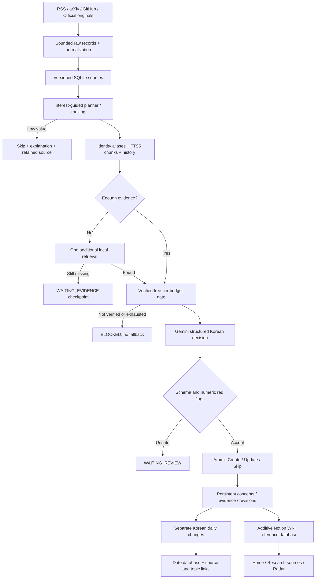

# Architecture and baseline audit

## Baseline inspected

At commit `e1d2798`, the repository had working RSS/Atom/arXiv/GitHub adapters, verified-TLS stdlib transport, SQLite source versions/topics/evidence/history/runs, token-overlap retrieval, Gemini object-schema decisions, a sample reasoner, ranking/archival, basic Notion paragraph updates, a CLI/scheduler, and 16 passing tests. A real three-source run created three Notion pages and an unchanged rerun made no writes.

The code was reusable but news-centric: a topic was essentially a summary; no aliases/canonical concept identity, FTS index, separate evergreen body, dated briefing database, claim checks, explicit research states, source-selection explanations, or free-pricing enforcement existed. Gemini model listing did not prove free eligibility. README originally described missing migrations accurately for that baseline, but is replaced for this version. Existing `VALIDATION.md` entries remain historical evidence, not claims about the latest gate.

The audit covered collectors, transport, models, intelligence, storage, orchestration, Notion adapter, CLI, package config, CI, and tests. Incremental changes reuse their working interfaces. No existing topic IDs, source records, canonical remote page IDs, or manual Notion blocks were deleted.

## Updated data flow

Curated starter notes take a separate explicit editorial path: fetch original references → persist source evidence → canonical concept identity → validated technical note/revision → daily knowledge-change record → same ranking/publishing. This requires no LLM and is not represented as automated news discovery.

## Components and contracts

| Component | Concrete behavior | Boundary |
| --- | --- | --- |
| `collectors.py`, `preparation.py` | Fetch supported formats; preserve raw bounded records; normalize text/dates | Metadata and source snippets, not a general web crawler |
| `discovery.py`, `config.py` | Six configurable ranking factors; source selection explanations | Heuristics, not learned preferences or peer-review verification |
| `retrieval.py` | Overlapping chunks, FTS5 BM25, exact aliases, source URLs, historical decisions | Lexical search; no embeddings or Korean morphological analyzer |
| `workflow.py`, `pipeline.py` | State traces, conditional extra retrieval, source checkpoints, validated persistence | Deterministic orchestration, not autonomous multi-agent planning |
| `free_tier.py`, `intelligence.py` | Exact official free-pricing verification, billing acknowledgement, bounded reservations/usage, Korean object schema | Cannot audit Cloud Billing through an API key; no paid fallback |
| `knowledge.py`, `enrichment.py` | Persistent concept/revision identities, adaptive technical bodies, date-based change views | Structural/citation checks are not a semantic fact checker |
| `workspace.py`, `notion.py` | Canonical reference pages + database metadata pointers + dates/navigation | No API support for moving old pages into a database or configuring Calendar views |
| `evaluate.py`, `tests/`, `scripts/verify_notion.py` | Measured retrieval, deterministic failure tests, real remote readback and idempotency checks | Small evaluated corpus; no production claim |

The classifier receives retrieved topic identities, previous concept excerpts, evidence excerpts and historical decisions. The successful live MCP run used retrieved topic ID 6 and chunk 43; the later concept/history prompt extension is covered by regression checks rather than a second live generation. Enrichment uses persisted evidence attached to the topic and prior content. External text is explicitly data, not authority for tool execution.

## Persistence

Original tables remain. Additive version-2 fields/tables introduce canonical keys/aliases, independent `wiki_json`, maturity/ranking explanations, source preparation records, revisions, topic links, briefing dates/changes, FTS chunks, selection logs, workflow events, generation usage/pricing proof and remote object hashes. Before first Wiki migration a SQLite backup is retained. There is no arbitrary future-schema migration framework.

`topics.summary` is the latest discovery summary; `topics.wiki_json` is enduring technical knowledge. Updating the first does not overwrite the second. Source revisions preserve raw content identity and evidence links. Wiki publication is an explicit action; shallow model summaries do not automatically become curated reference pages.

## Reliability

Per-source decisions commit with their source completion/history/evidence relationship. Sparse sources pause unprocessed after one bounded local retrieval. Repeated confirmed source hashes skip inference. The whole run records success, partial, or failed status. A failed tool/generation leaves pending sources retryable; completed sources remain committed. Workflow events and HTTP service/status/timing diagnose decisions without credentials.

Notion object IDs and content hashes are checkpointed. Only owned blocks are patched; unknown blocks remain untouched. New confirmed IDs are persisted before dependent writes. HTTP GETs retry limited transient statuses; POST/PATCH are not automatically retried. There is an unavoidable acknowledgement/crash window without a Notion idempotency API: inspect ambiguous writes before resuming. Single writer per SQLite store; distributed concurrency and automatic reconciliation are not implemented.

## Conversational assistant extension

The curation pipeline and Notion layouts remain intact. A separate local FastAPI service adds `question → deterministic conversation-aware expansion → shared FTS5/source relationships → budgeted context → existing free-tier Gemini generator → structured citation verification → Korean response`. No Notion scraping, publishing route, paid service, new vector store or autonomous tool execution was introduced.

`chat_retrieval.py` reuses the actual FTS engine and topic/source/related-topic links, with aliases/paraphrases, multi-topic diversity and prior focus. `chat.py` manages ephemeral bounded sessions, structured answer labels, identifier/quote/quantity checks, redaction, metadata-only traces and shared policy accounting. `chat_web.py` serves same-origin static assets and API, bound to loopback. FastAPI/Uvicorn are optional dependencies; core commands remain independent of the web extras.

SQLite knowledge is shared, including immediate retrieval of curation updates; only indexes, link cache, chat event metadata and the existing token ledger are written. No raw conversation is persisted by default. Notion URL cache entries are validated using explicit GET requests; original URLs originate from retrieved persisted records. The browser cannot supply generation settings, credentials, tool permissions or target database paths. No publicly accessible chatbot URL was created, so no dashboard link was added.

A process-wide 1..3-request budget is shared across sessions and request threads under a lock. Per-request SQLite connections preserve thread ownership while the shared policy rebinds its ledger connection. New conversation does not reset quota. HTTP timeouts/status metadata were added backward-compatibly; original curation defaults remain 30-second timeout/bounded GET retries, while chat uses 15 seconds and no retries. Existing 35 regressions plus 24 chatbot tests pass.

The response verifier proves selected identifier/quote correspondence, not semantic entailment. Rule expansion has limited coverage, project-introspection questions conservatively abstain, explicit conflict questions require attributed uncertainty, and only one compact prior turn is included in inference. Detailed contracts, evaluation and actual browser evidence: [CHATBOT.md](CHATBOT.md).
