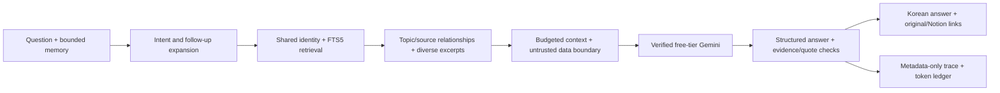

# AI Technology Radar Assistant

A conversational, local RAG interface over the **same SQLite knowledge base** as the curation agent. It explains concepts, compares technologies, connects evidence to engineering scenarios, remembers bounded follow-ups, and exposes uncertainty. It does not scrape Notion, replace the curation pipeline, or publish user conversations.

## Run

```bash
python3 -m venv .venv
. .venv/bin/activate
python -m pip install -e '.[chat,test]'
# Select your existing database; do not reset it or publish a new database to the same workspace.
# For a fresh local reference corpus only: ai-radar --db var/radar.sqlite3 bootstrap
# Optional: validate/cache canonical Notion URLs (GET only; requires existing Notion bindings):
radar-chat refresh-links --db var/live-integration.sqlite3
# Only acknowledge this when Cloud Billing is disabled for this API key's project:
export GEMINI_BILLING_DISABLED=true
radar-chat serve --db var/live-integration.sqlite3 --port 8000 --max-requests 2
```

Provide `GEMINI_API_KEY` securely on the backend. `.env` is not automatically loaded. The server binds **127.0.0.1 only**. Open the address printed by the local server on that machine. No cloud deployment, billing setup, paid fallback, or public chatbot URL was created. No link was added to the Notion dashboard because a loopback service is not an accessible deployment for other Notion users.

Chat dependencies are optional: FastAPI 0.162.0, Uvicorn 0.54.0; offline API tests use httpx 0.28.1. The original CLI/core still has no third-party runtime dependencies. All regression tests require the `chat,test` extras. This is a single-user local service: do not expose it publicly or run multiple workers. There is no account authentication or distributed session/quota coordination.

## Architecture



- `chat_retrieval.py` calls the existing `retrieval.retrieve`, rather than maintaining a second search index. Korean particles around English acronyms, current topic aliases, lightweight synonym rules, multi-topic expansion and last-focus resolution improve conversational search. Focus rules are transparent and limited; they are not embeddings or unrestricted semantic understanding.
- `chat.py` assembles context, manages privacy-bounded memory, calls the existing `GeminiReasoner.generate`/`FreeTierBudget`, validates output and records metadata. Selected topic-to-topic relationships accompany source relationships. The chatbot reads curation knowledge and writes only chat metadata/link cache/usage and shared retrieval indexes, never topic bodies or briefing records.
- `chat_web.py` serves the FastAPI API and local static UI. Browser assets contain no credentials, CDN dependencies or paid scripts. The UI renders text using `textContent`, has source cards, loading/error states, new conversation, keyboard handling and responsive layout.

## Retrieval and generation

The question is understood deterministically: explanation, comparison, application, explicit conflict, ambiguity or an obvious evidence gap. Query rewriting combines relevant existing aliases and previous focus for follow-ups without spending another model request. Independent FTS queries for explicitly mentioned technologies prevent one topic from crowding a comparison. The source excerpts are selected through persisted relationships and the shared chunk index.

Context is bounded to 2,600 UTF-8 bytes of evidence text, up to three selected topics and one original excerpt per topic. Titles/identifiers add a small bounded payload; the existing conservative serialized-payload budget is the final gate. Context selection emphasizes comparisons or implementation/limitations; permission/latency questions select relevant sentences. No-anchor queries conservatively abstain instead of treating a generic FTS match as evidence.

The model receives untrusted user data, one compact previous turn, selected Wiki excerpts, original excerpts and topic relationships, under a separate system instruction. It must explain and synthesize, not dump a page. Response segments are labelled:

- **Stored evidence** (`grounded`): linked to retrieved knowledge.
- **Technical interpretation** (`inference`): reasoning from identified evidence.
- **General knowledge** (`general`): explicitly not verified against the store.
- **Uncertainty** (`uncertain`): missing or conflicting information.

A fully uncertain response with no citations is accepted as an explicit evidence gap rather than falsely reported as a grounded answer. Every cited identifier must refer to actual selected evidence, with a literal supporting quote present in that excerpt. All cited IDs need quotes; unknown IDs, invented quotes/URLs, unsupported quantitative figures and near-verbatim passage dumps are rejected. Only cited evidence is returned as sources; browser URLs come from the database/link cache, never model-generated URLs. Supporting quotes are validated internally; source cards show the bounded source excerpt for inspection.

These are **citation-integrity and numeric checks, not a semantic entailment proof**. A valid quote can still be paired with a bad interpretation. Explicit conflict questions require an uncertainty segment citing at least two excerpts; hidden contradictions are not reliably detected. Direct requests for secrets/system prompts are refused before inference. Retrieved instructions never gain tool-execution privileges: no tool calling, Notion writes, filesystem tools or code execution is available to the model.

Project-specific implementation questions currently abstain because generic AI Wiki notes do not establish the repository's actual architecture. A future explicit repository-document indexing adapter can expand that scope; the chatbot does not invent Redis/vector databases or other undocumented project components.

## Memory, privacy and operations

- In-memory sessions: at most 64, one-hour idle expiry checked on the next question, four stored turns; only the latest compact question/answer pair plus focus is sent to Gemini. This is not persistent or long-range conversational memory.
- New conversation deletes its previous server memory and does **not** reset the server-wide generation budget. Session tokens stay in browser memory, not localStorage. Random tokens are not written to logs; traces use a process-salted hash.
- Logs default to `var/chat.log` (rotation 1 MB, three backups). Records contain request ID, status, latency, topic/source identifiers, context size and used evidence IDs—no questions, answers, query terms, credentials or raw provider errors. Trace metadata still reveals technical topics accessed. `chat_events` stores this same metadata, not conversation text.
- `generation_usage` reuses the existing reservation, pricing proof and actual provider token fields. No key values are recorded. Three deliberately public test conversations/screenshots were saved as **opt-in validation artifacts** under ignored `var/`; this is not default chat logging.
- One request is processed at a time; concurrent requests get a clear busy response. Default request spacing is 0.5 seconds and the service permits at most ten questions/minute. SQLite connections are owned by the request thread; the shared budget is rebound under the single-request lock.
- Provider calls use a 15-second socket timeout. Chat price reads have one attempt; generation is never automatically retried. Browser requests abort after 45 seconds. A browser abort may occur after a server processed the request; it does not trigger an automatic paid or duplicate retry.
- Trusted hosts, same-origin mutation checks, CSP, no HTML insertion, response size/input limits and disabled Uvicorn request access logs reduce local browser risks. These are not a substitute for authentication on a public deployment.

## Strict free-tier budget

Current default is `gemini-3.5-flash-lite`, verified against Google's exact-model **Standard Free Tier** input and output prices before the first generation. The server requires `GEMINI_BILLING_DISABLED=true`; the user has confirmed the current key's project has billing disabled. The key itself cannot prove billing status. Unknown pricing or missing acknowledgement blocks generation.

The **whole server process**, across conversations, allows 2 generations by default (`--max-requests` 1..3), input upper bound 9,000, output ceiling 1,600 and reserved total 18,000 tokens. Each request asks for at most 1,400 output tokens. Quota failures stop the shared policy; no model/provider switch or automatic quota workaround exists. New conversations cannot reset it. A manual process restart creates a fresh local budget, not fresh provider quota; it must not be used to bypass provider quota exhaustion. This deliberately restrictive initial policy is suitable for a private proof of functionality, not unlimited chat.

## Tests and measured results

```bash
python -m unittest discover -s tests -v
PYTHONPATH="$PWD/scripts/ci_offline" python scripts/ci_chat_evaluate.py
```

The 12-question fixture includes Korean/English facts, comparisons, two follow-ups, paraphrases, ambiguity, no-evidence questions and a prompt-extraction attempt. Eight positive queries measured mean topic Recall@3 **0.6875 for baseline FTS → 1.0000 for chat expansion**. All four gap/safety cases avoided unrelated evidence. On the current real SQLite corpus, the same small labelled queries gave the same scores; mean comparison latency was **9.92 ms**, including both retrieval paths. This is an in-repository regression, not a held-out semantic benchmark.

**58 automated tests passed**, zero skipped: the original 35 plus chat retrieval, memory, citations, source-instruction boundaries, redaction, quote/quantity/URL validation, conflicts, API/UI assets, local origin/host rules, quota behavior and shared-budget connection changes. CI installs optional extras, keeps all checks offline, runs both evaluation suites and smoke-tests the installed CLI and bundled web assets. Current Starlette emits an httpx TestClient deprecation warning; tests still pass and no warnings are misreported as skipped tests.

### Actual Chromium/Gemini checks

- Desktop: compared RAG and MCP, then answered a context-dependent follow-up on permissions/latency. Both HTTP 200, linked the same references, no browser page errors.
- Mobile at 390px: a source-focused question explained RAG parametric/non-parametric memory and the official MCP repository. It cited both original documents and canonical Notion links; source cards opened and no horizontal overflow occurred.
- New conversation, missing-knowledge response and exhausted local-budget error were verified in the actual UI without extra generation. A harness initially used `wait_for_function` string evaluation, which CSP correctly blocked; selector-based waits fixed the harness without weakening CSP. A too-fast quota assertion initially hit the 0.5-second throttle; respecting the documented interval verified the quota response.
- **Three live generation requests total**, in two explicitly bounded validation server invocations (2 requests, then 1 targeted attribution check), **4,775 tokens**: 1,598 + 1,595 + 1,582. Official free-tier eligibility was checked for each server; billing was not enabled or changed. No extra model calls were used for UI error checks or evaluation.
- Server answer latency: **10.35 s, 8.07 s, 6.07 s**. The first turn in each server includes pricing verification. Seven evidence-bearing segments had valid citation contracts; one additional general-knowledge paragraph was explicitly labelled. These counts do not establish a semantic unsupported-claim rate.
- Manual completeness rubric: first answer 3/3 role/application checks, follow-up 2/3 (both permission layers and tool timeout addressed, retrieval/model latency decomposition incomplete), original-source answer 3/3 memory/specification/attribution checks. **8/9 checks**, one reviewer, three examples—not a benchmark. Later sentence targeting improves latency context in deterministic tests but was not used to claim a revalidated follow-up answer.

## Example conversations actually tested

> RAG와 MCP의 역할을 비교하고 사내 문서 QA 에이전트에서 어떻게 함께 사용할지 설명해줘.

The answer distinguished external-document retrieval/context from tool/data connectivity, explained their composition, and labelled the practical combination as interpretation.

> 그럼 둘을 연결할 때 권한과 지연시간은 각각 어디서 점검해야 해?

It retained both topics, discussed retrieval permission filters, tool allowlists and timeout boundaries; broader latency decomposition remained incomplete.

> RAG 원논문은 parametric/non-parametric memory를 어떻게 결합한다고 설명하고, MCP 공식 저장소는 어떤 규격을 제공하나요? 원문 근거를 각각 인용해 비교해줘.

The answer cited [the original RAG paper](https://arxiv.org/abs/2005.11401) for the seq2seq/dense-index distinction and [the MCP repository](https://raw.githubusercontent.com/modelcontextprotocol/modelcontextprotocol/main/README.md) for the specification/schema/docs, retaining Notion navigation.

## Remaining limits

Rules cover known aliases and selected engineering paraphrases, not arbitrary semantic matches. Context can omit details; source ranking is not an entailment verifier. Project implementation introspection is deliberately limited. Sessions are ephemeral, one compact prior turn is used, generation limits are very small, provider quota behavior was not induced by exhausting real quotas, and the local service must not be exposed publicly. The separate full-reference Gemini enrichment remains subject to its own validation limits; chatbot validation does not establish unrelated curation accuracy.
